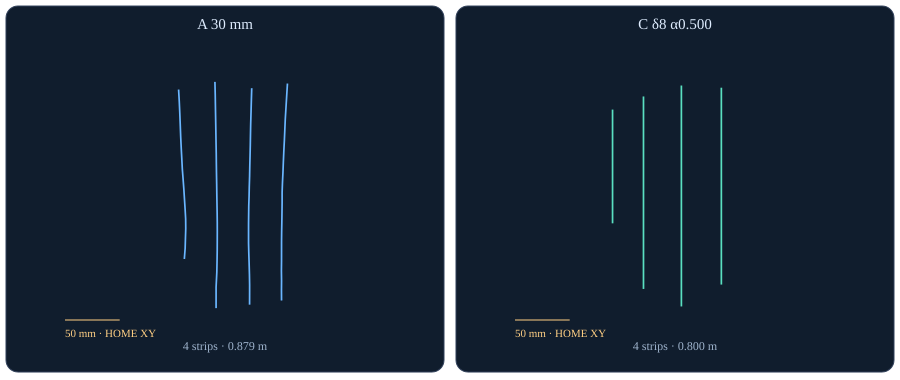
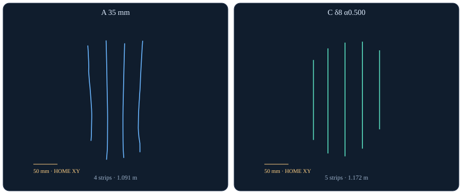
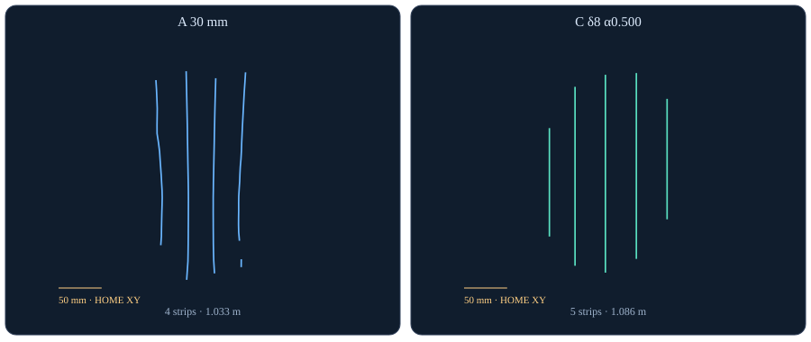
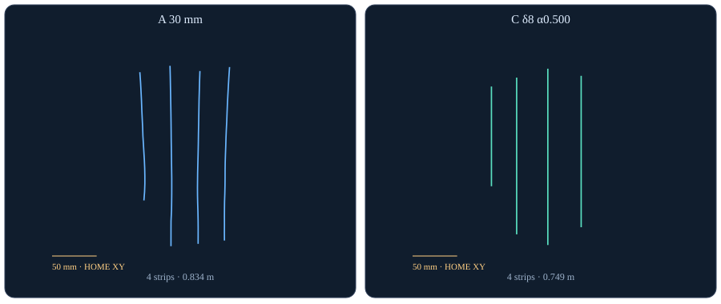

# 보완선 없는 완화 Raster: 최종 비교와 실행 범위

2026-11-05 · R90 우측 한쪽 유방 합성 형상 연구 · `execution_ready=false`

**완화 우선 대표 설정은 C α=0.5, 계획 δ=8 mm, 보완선 OFF다.** 카메라 유래 breast 114조건에서 논리 선 수 중앙값 4개, 실제 스캔 길이 중앙값 0.846 m였다. 같은 평가 δ의 실제 A 길이–피복 envelope 보간 대비 이득은 중앙값 **+5.303%p**, 최소 **−1.293%p**, 음수 **2/114건**이다. 최대 피복이나 최소 빈틈의 설정이라는 뜻은 아니다.

이 대표는 20 mm 이상 수치 빈 영역 **51개가 44/114조건**에 남았고 최악 지름은 **33.170 mm**다. 20 mm는 잠정 관찰 기준이며 허용·채택 기준이 확정된 것은 아니다. **제품 기본 A, main 및 로봇 경로는 바꾸지 않는다.** δ8이 실제 조직에서 달성 가능하다는 근거나 보정된 힘 명령은 없다.

## 실제 비교 범위

| 원기록 | 행 수 | 출력 | 역할 |
|---|---:|---:|---|
| 정규 A 15/20/25/30/35/40/45/50 mm | 2,432 | 1,728 | 실제 sampler·selector·converter·full session |
| C δ3/5/8 × α0.5/1, 보완선 OFF | 1,824 | 1,824 | 기존 배치 수식 + 명시적 새 frame |
| 별도 A 진단 | 704 | 704 | 유두 확인 실패 88조건×8간격; 제품 A 대체 금지 |
| 표적 추가 A 측정 | 9 | 9 | 한 조건의 55/60/70/80/100 및 네 조건의 10 mm |

기본 4,256행은 19형상×gt/none/realistic/severe×nipple ON/OFF×두 ROI×14설정이다. 진단·추가 측정을 합쳐 원기록은 **4,969행**이다. 추천은 breast 카메라 유래 3수준의 공통 114조건이다. `both_chest_40mm`는 같은 R90 우측 유방의 **상·하 흉벽 포함 ROI**이며 양쪽 유방이 아니다. 별도 ROI를 추천에 섞지 않았다.

모든 방법은 조건별 동일 raw/common PN·nipple·HOME·평가 ROI를 사용한다. gt는 메시 유래의 이상적 입력 민감도 실험으로 카메라 입력과 분리했다. 독립 평가 메시를 계획기에 전달하지 않았다. common PN은 관측 위치의 제품 surfel 재융합·품질선별이며 원래 등록 이력 전체의 재현은 아니다. 가상 HOME에서 실제 제품 코드를 실행한 합성 연구이며 환자·임상 분류·진단 성능 검증이 아니다.

C δ3/5는 이전 출력의 보완 조각만 제거해 MAIN PN 1,216행을 byte-exact 보존했다. δ8은 같은 수식으로 보완선 없이 생성했다. 새 frame은 **+Z=평활한 outward N, +X=global HOME +Y의 접평면 투영, +Y=Z×X**다. frame 변경으로 XYZ를 옮기지 않았고 끝단 패스·보완선·자세 rate cap을 더하지 않았다. A는 기존 −Z outward / Y longitudinal frame이다.

## 114조건과 A8·진단·추가 측정의 구분

A8만으로 δ3·α1은 110/114, δ8·α0.5는 113/114였고 나머지는 114/114였다. **추가 측정 후에만 여섯 설정 모두 114/114의 실측 길이 범위**를 확보했다. 기존 A8과 C 기하는 그대로다.

nipple_protruding/realistic/breast/ON의 C8·α0.5는 0.810607 m로 A8 최소 0.910173 m보다 짧았다. A55/60/70/80은 같은 0.910173 m plateau였고 A100의 0.664403 m에서 실제 bracket을 얻었다. full-session 유두 gate를 유지하되 audit 50 mm를 사용한 UI 범위 예외 측정이다.

δ3·α1이 A8 최대 길이를 넘은 severe 네 조건(medial_cluster ON/OFF, narrow_chest_large OFF, upper_full OFF)은 별도 진단 A10으로 실제 상한을 확보했다. 진단 A10은 strip selector·converter를 유지하지만 유두 확인·full session·force packet·audit는 없다. A15/20도 sampler 값과 audit 25 mm를 구분한 연구 예외다. 어느 예외도 UI 지원·실행 준비를 뜻하지 않는다.

이전 47조건은 동일 조건 추적에서 **11건 확장 정규 A 범위 +36건 명시적 별도 진단 A**로 구분됐다. 47건 모두 제품 A 성공이라는 뜻이 아니다. 정규 A 무출력 704행(gt 128, severe 576)은 유두 surfel 확인 거절로 유지했고, 별도 진단도 per-strip 품질선별은 유지한다.

## A8: 실제 길이와 피복의 기준점

none / breast / 평가 δ8, 간격별 38조건의 중앙값이다. 명목 8설정은 pixel 양자화로 같은 경로·길이를 만들 수 있다. 이 중앙값끼리 보간하지 않고 효율은 조건별 실제 A 점으로 계산한다. 마지막 열은 case 최대 내접 지름의 중앙값이다.

| A 간격 mm | 논리 선 수 | 길이 m | 피복 % | ≥10 mm 개수 | ≥20 mm 개수 | 최대 빈틈 mm |
|---|---:|---:|---:|---:|---:|---:|
| 15 | 7 | 1.786 | 89.631 | 3 | 1 | 34.251 |
| 20 | 6 | 1.362 | 89.484 | 3 | 1 | 34.251 |
| 25 | 5 | 1.142 | 89.155 | 3 | 1 | 34.251 |
| 30 | 4 | 1.025 | 88.860 | 3 | 1 | 34.251 |
| 35 | 4 | 0.909 | 88.860 | 3 | 1 | 34.251 |
| 40 | 4 | 0.877 | 88.618 | 3 | 1 | 34.251 |
| 45 | 3 | 0.743 | 87.222 | 3 | 1 | 34.251 |
| 50 | 3 | 0.671 | 85.091 | 3 | 1 | 34.251 |

## 대표 설정의 입력별 같은 예산 피복

계획 δ=평가 δ=8. 이득은 동일 조건의 A 누적 최선 envelope 선형 보간 차이로, 새 동일 길이 A 실행의 실측 차이가 아니다. gt는 추천 분모에서 제외한다.

| 입력 | 범위 내 / 제공 | 정규 gate A / 별도 진단 A | 이득 med %p | 이득 min %p | 음수 |
|---|---:|---:|---:|---:|---:|
| gt | 38/38 | 30 / 8 | 4.414 | -0.258 | 1 |
| none | 38/38 | 38 / 0 | 4.870 | -0.644 | 1 |
| realistic | 38/38 | 38 / 0 | 4.763 | -1.293 | 1 |
| severe | 38/38 | 2 / 36 | 5.965 | 2.669 | 0 |

카메라 114조건은 정규 gate A 78조건과 별도 진단 A 36조건이다. 진단을 제외한 정상 A만의 78조건 민감도에서도 대표는 α0.5·δ8이며 이득 med +4.784%p, min −1.293%p, 음수 2건이다. 추가 범위 예외가 필요한 비교는 source 수와 겹치므로 별도 성공 수로 더하지 않는다.

## 여섯 설정의 완화–피복–빈 영역 손익

모두 같은 114조건, 계획 δ=평가 δ다. 선 수·길이는 case 중앙값, 운동은 **각 case의 실제 10 mm 창 최댓값들의 중앙값**이다. heading은 longitudinal X의 HOME XY 방위 변화이며 Euler X roll이 아니다.

| δ mm / α | 선 수 | 길이 m | 이득 med / min %p | 음수 | ≥20 mm 성분 / 조건 | heading °/10 mm | tilt 변화 °/10 mm |
|---|---:|---:|---:|---:|---:|---:|---:|
| 3 / 0.5 | 6 | 1.144 | 7.676 / 0.713 | 0 | 78 / 66 | 12.980 | 14.004 |
| 3 / 1 | 7 | 1.383 | 11.579 / 4.705 | 0 | 15 / 10 | 13.098 | 13.868 |
| 5 / 0.5 | 5 | 0.957 | 6.530 / 0.576 | 0 | 70 / 64 | 13.528 | 13.474 |
| 5 / 1 | 6 | 1.128 | 8.882 / 0.861 | 0 | 29 / 25 | 13.279 | 13.720 |
| 8 / 0.5 | 4 | 0.846 | 5.303 / -1.293 | 2 | 51 / 44 | 13.053 | 13.068 |
| 8 / 1 | 6 | 1.084 | 7.998 / 0.827 | 0 | 32 / 26 | 13.265 | 13.503 |

대표는 양의 중앙 보간 이득을 갖는 공통 조건의 Pareto 후보에서 선 수·길이 완화를 우선한 보고 기준이다. **빈 영역 최소가 우선이면 δ3·α1**은 ≥20 mm 15성분/10조건으로 더 적지만 선 수 7개·길이 1.383 m로 조밀하다. α0.5·δ8을 보편적 최적이나 물리 acceptance gate 통과로 부르지 않는다.

고정 C8·α0.5 기하에 평가 δ만 3→5→8로 바꾸면 피복 med **89.747→92.445→93.085%**, ≥20 mm 성분 합은 **110→69→51**이다. 이는 눌림 폭 가정 민감도다. 계획 δ를 바꿔 배치를 달리한 위 표와 구분해야 하며 δ8은 보정된 힘·압력 명령이 아니다.

## 빈 영역: 실제 nearest A와의 비교

개수는 각 미피복 연결 성분의 최대 수치 표면 내접 지름이 ≥10/20 mm인 성분 수다. point 접촉은 합치지 않고 가는 미피복 통로는 연결한다. 면적·topology·정점 peak는 해상도에 의존한다. 20 mm는 잠정 관찰 기준이며 임상 허용 기준이 아니다.

실제 A와 C 길이가 정확히 같은 사례는 **0/114건**이다. 정수 개수는 보간하지 않고 실제 nearest A의 값을 쓴다. 모든 shorter/nearest/longer 길이 bracket은 정적 상세 표에 있으며, 아래 C−A 길이 차이를 함께 읽어야 한다.

| 입력 | C/A ≥10 med | C/A ≥20 med | C/A ≥20 합 | C/A 최악 지름 mm | C−A 길이 med m | C ≥20 악화 건 |
|---|---:|---:|---:|---:|---:|---:|
| none | 2 / 3 | 0 / 1 | 16 / 60 | 33.170 / 45.555 | -0.044 | 1 |
| realistic | 2 / 3 | 0 / 1 | 18 / 56 | 33.170 / 45.555 | -0.008 | 2 |
| severe | 2 / 3 | 0 / 2 | 17 / 63 | 31.411 / 45.239 | 0.002 | 1 |
| all | 2 / 3 | 0 / 1 | 51 / 179 | 33.170 / 45.555 | -0.007 | 4 |

C ≥20 mm 51개는 nearest A의 179개보다 적지만 서로 길이가 다른 측정이므로 정확한 동일 길이 물리 빈틈 우위는 아니다. C의 ≥20 mm 개수가 nearest A보다 많은 조건도 4건이다.

## 위치 증거와 domain 원인 후보

성분 peak의 중복 가능한 기하 flag다. nipple은 투영 nipple부터 표면 거리 ≤20 mm, lateral은 R90 negative-X 끝단·경계 근접, boundary는 ROI 경계 표면 거리 ≤20 mm, between-strips는 내부 peak의 서로 다른 조각 X bracket이다. 원인·실제 접촉 실패를 확정하지 않는다.

| 지름 기준 | 성분 / 조건 | nipple 근처 | lateral 끝단 | ROI 경계 내부 | 선 사이 내부 | supplied mask 밖 / 미확인 |
|---|---:|---:|---:|---:|---:|---:|
| ≥10 mm | 211 / 105 | 0 | 132 | 211 | 0 | 0 / 0 |
| ≥20 mm | 51 / 44 | 0 | 33 | 51 | 0 | 0 / 0 |

대표의 ≥20 mm 51성분은 모두 ROI 경계 zone이며 33개는 lateral과 겹친다. 이 51개 peak에서 실제 공급한 C scan_domain_mask 밖이라는 증거는 0개다. 이 subset의 domain mismatch가 확인되지 않았다는 뜻이며 전체 정의가 옳다는 증명은 아니다. 실제 mask를 공급하지 않은 A/진단 A의 domain 원인은 미확인을 정상 또는 0으로 대체하지 않는다.

## 네 고정 형상의 실제 경로

none / breast / nipple ON, 대표 C8·α0.5와 실제 nearest A를 같은 XY 축으로 그렸다. 보완선 없이 실제 모든 조각을 유지한다. 같은 길이 실행을 뜻하지 않는다. GT 메시·raw NPZ는 공개하지 않는다.


*medium_reference: C−A 실제 길이 -0.078 m. 원본 case/그림 SHA-256은 figure manifest에 보존.*


*large_sag: C−A 실제 길이 +0.081 m. 원본 case/그림 SHA-256은 figure manifest에 보존.*


*narrow_chest_large_sag: C−A 실제 길이 +0.053 m. 원본 case/그림 SHA-256은 figure manifest에 보존.*


*asymmetric: C−A 실제 길이 -0.085 m. 원본 case/그림 SHA-256은 figure manifest에 보존.*

## 실제 PC 재현과 힘 부호의 범위

PC(17)는 검증된 제품 Python/native 환경과 HOME·metre 단위·outward N 부호가 필요하다. [오프라인 실행 문서](../Integration/tools/replay_adaptive_relaxed.md)의 코드 pin `5b1abff0a0d893f188afbfac5796a8701c855e20` 및 설치별 환경을 따른다. packet은 PN·nipple·ROI boundary·HOME 보정이 필요하다. 아래 경로는 예시다.

```bash
python3 Integration/tools/replay_adaptive_relaxed.py \
  --mode all --input /data/packet.npz --home /data/home.json \
  --output-dir /data/results/relaxed-off-01 --cache /data/cache/packet-surfels \
  --alpha 0.5 --indentation-mm 8 --center-pass off \
  --diagnostic-a-if-nipple-unconfirmed
```

ON은 새 output-dir에서 `--center-pass on`으로 반복한다. 실제 A 범위가 C를 bracket하지 못할 때만 별도 `--spacing-mm 10` 또는 `100`과 `--allow-extended-a-measurement`를 명시한다. 추가값은 자동 선택하지 않고 C를 수정하지 않는다. 정규 유두 거절과 명시적으로 요청한 진단 row를 각각 남긴다.

wrapper는 frame 변경 시 기존 force 배열 수치를 보존할 뿐이다. **+toolZ outward 이후 PC(17)의 signed forceN 방향·조직 눌림·압력 변환은 미검증이다. 로봇(18)의 frame/부호·충돌·접근·lift·controller 실행도 미검증이다.** 이 코호트나 명령은 로봇 전송·구동 지시가 아니다.

## 무결성·한계·마무리

독립 감사는 기본 4,256행의 JSON/NPZ·실제 XYZ/RPY·길이, C 1,824행의 보완선 0과 새 frame, 기존 A 1,520행의 PN/RPY bytes, C MAIN 1,216행의 원본 PN bytes를 확인했다. 진단 704행은 정규 유두 거절 88조건과 정확히 대응하며 selector 유지·no force packet·not-ready다. 추가 9행의 원본 C/기본 A8 hash도 그대로다.

평가 폭 W=min(50 mm,2√(2Rδ))는 등방성 원판 가정이다. 진행 횡방향 곡률은 실제 tool 폭 축·직사각형 footprint가 아니며, 0.5 mm 반지름 bin 상·하한은 양자화만 감싼다. GT projection 잔차와 실제 부착은 별개다. triangle FMM·곡률·source·ROI quadrature·hole peak 수렴을 인증하지 않았다.

계산 crop은 원래 GT projection·곡률·ROI 분모·경계거리를 보존한다. 기존 full/cropped 32실제 case×2δ에서 해당 평가량이 bit-identical이었지만 crop 밖 전체 거리장 동등성을 주장하지 않는다. A full-session, C core, 진단 sampler-only와 동결 δ3/5 시간을 섞어 속도 순위를 정하지 않는다.

조건부 수치 이득은 후속 검증의 근거이며 기본값 전환의 근거는 아니다. 보완선 제거·선 수와 길이 완화 연구는 이 결과로 마무리하고 실제 조직·힘 부호·압력·로봇 실행을 별도로 검증한다.

보고서 코드 `3b74a2f` · 원기록 SHA-256과 집계: [요약 JSON](ADAPTIVE_RELAXED_SUMMARY_20261105.json) · [그림 manifest](figures/adaptive-relaxed-20261105/figure-manifest.json). [최종 정적 보고서 예정 주소](https://autosonix-adaptive-relaxed-20261105.irocks0922.chatgpt.site/adaptive-relaxed/)는 배포 전까지 공개 완료의 증거가 아니다. 11월 4일 기존 보고서는 보존한다.
