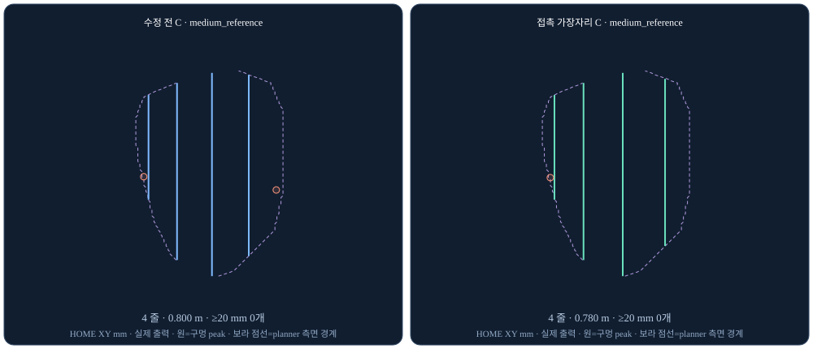
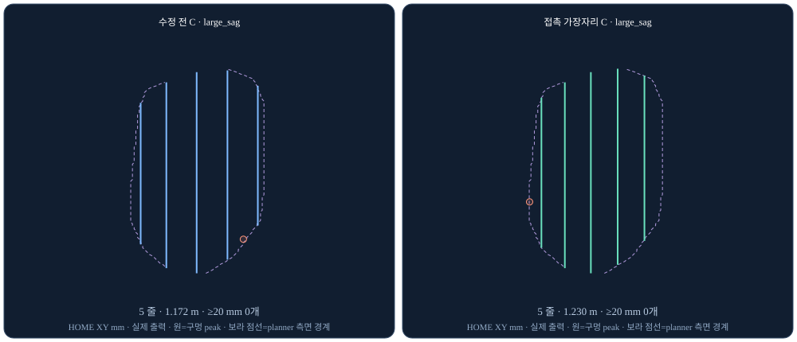
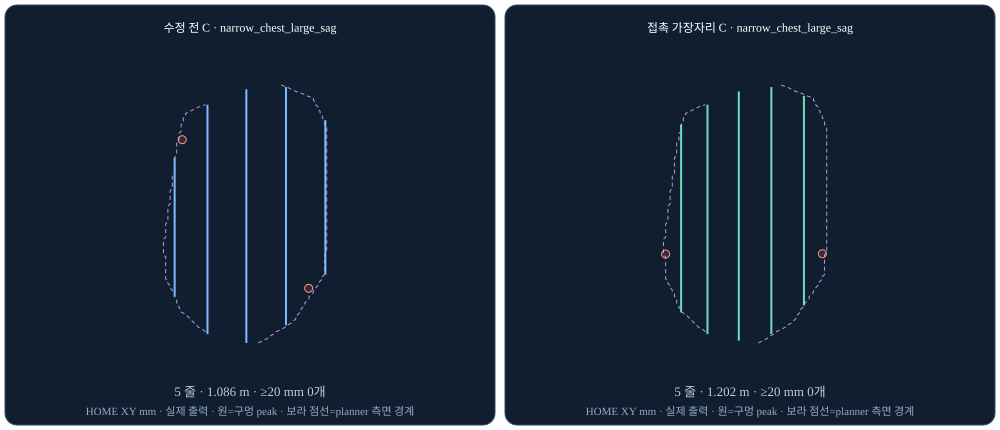
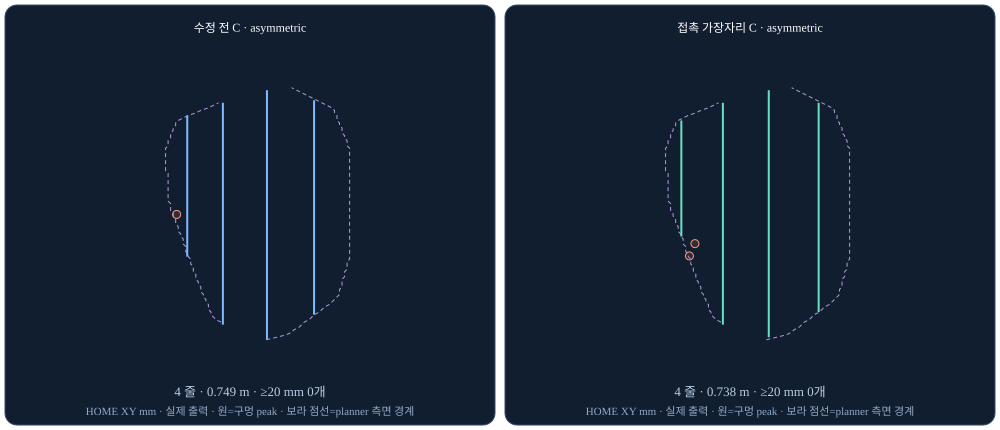

# 대표 C: 고정 줄 수 접촉 경계 배치 검증 — 2026-11-05

대표 C는 α=0.5, 계획 δ=8 mm, 보충 없음으로 유지한다. `boundary_policy='contact_edge'`를 연구용 명시 옵션으로 추가했다. 제품 기본값, 기존 A·C legacy 배치, main, 장비 명령은 변경하지 않았다. 전체 출력은 preview_only이며 실행 준비를 하지 않는다.

- [정적 수치·실제 출력·관측 점군 3D](https://autosonix-adaptive-relaxed-20261105.irocks0922.chatgpt.site/adaptive-edge/)
- [외부 AI용 정적 사이트](https://eclipse0922.github.io/autosonix-adaptive-relaxed-20261105/adaptive-edge/)
- [이전 A 효율 곡선](https://autosonix-adaptive-relaxed-20261105.irocks0922.chatgpt.site/adaptive-relaxed/)
- [실데이터 PC 재생](replay.md#contact-edge-representative-explicit-opt-in-same-number-of-strips)

## 코드와 재현 기준

플래너·재생 코드: `7178cefe7df7c7aef5bf25ee17ed0cb8560e6f61`.
보고서 생성 코드: `49641d8bb8af0d519066ea038417a9ba5f66357d`.
전체 수치 생성 후, 중간 저장 재개 검사만 보강한 실행기 커밋: `788888699501a7a5ed9d03f4c529bea3efe38e54`. 이 보강은 플래너나 이미 생성한 수치를 바꾸지 않는다. 실제 사용 실행기 사본과 해시는 로컬 `full/verify_adaptive_edge.runtime-used.py`, `runtime-freeze.json`에 보존했다.

입력은 기존 MPFB R_090(오른쪽 유방·팔 90°) 19체형의 동일 등록 PN이다. breast는 유방 ROI, both_chest_40mm는 같은 유방 위·아래 흉벽 포함 ROI로 양측 유방이 아니다. 19×GT/none/realistic/severe×ON/OFF×2 ROI = 304조건, 각 3회 계획했다. GT 입력은 이상적 참고 38조건/ROI로 카메라 유래 none/realistic/severe 114조건/ROI와 분리했다. 평가 GT 메시·법선·접촉 폭은 플래너로 전달하지 않았다.

## 배치 변경

기존 C에는 고정 20 mm 인셋이 없다. 중앙에서 폭·경사 기반 간격을 반복 배치하다 경계 전에 멈춘다. 이번 변경은 이 실제 출력 대비이다.

`adaptive_edge_placement.py`는 강하게 평활한 관측 높이 표면의 횡단 3D 호길이를 적분한다. 각 종방향 행에서 경계까지의 표면 거리가 유효 접촉 반폭 W/2가 되는 X를 구한다. W=min(50 mm, 2√(2Rδ))이고 실제 관측 기반 곡률을 사용한다. 하나의 직선 줄이 Y에 따라 변하는 경계 전체에 동시에 닿을 수는 없으므로, 도달하는 경계 호길이를 최대화하고 잔차·이동량으로 결정적으로 동률 처리한다. 모든 행의 미도달·지원 없음·잔차를 기록한다. 모든 경계에 완전히 닿았다는 주장은 하지 않는다.

중앙 줄과 좌우 기존 줄 수를 고정한 뒤, 내부는 기존 C의 폭 p20·경사 p80·cos^α 간격 밀도를 적분해 재분할한다. 줄 추가나 보충을 하지 않는다. `contact_edge`와 supplements=True는 함께 사용할 수 없다. 기본은 legacy이다.

## 핵심 결과: 카메라 유래 breast 114조건

아래 δ는 평가 접촉 모델만 바꾼 값이다. C의 계획 δ=8 mm와 경로는 모두 고정이다. 덮음률 전·후는 각각의 중앙값이며, 대응 조건별 차이의 중앙값과 구분한다.

| 평가 δ mm | 덮음률 중앙 전→후 % | ≥10 mm 구멍 전→후 | ≥20 mm 구멍 전→후 | 수정 후 같은 길이 A 이득 중앙/최소 %p | 음수 |
|---|---:|---:|---:|---:|---:|
| 3 | 89.747→92.568 | 286→239 | 110→61 | +9.289 / +1.599 | 0/114 |
| 5 | 92.445→96.051 | 221→172 | 69→48 | +9.017 / +0.711 | 0/114 |
| 8 | 93.085→96.694 | 211→157 | 51→37 | +8.218 / +1.242 | 0/114 |

각 δ에서 114/114가 실제 측정 A 길이 범위 안이다. 정상 A 78조건과 유두 확인을 생략한 진단용 A 36조건을 별도 표시한다. 덮음률만 같은 길이 누적 최선 A envelope로 보간한다. A 경로·구멍 수를 보간하거나 범위 밖으로 외삽하지 않는다.

전체 304조건 출력 304, 계획 실패 0, 실제 논리 줄 수 변화 0/304, 보충 0이다. 세 번의 경로·자세 해시가 모두 같고 중앙 PN은 전·후 304/304 바이트 동일하다. 주 비교 줄 수 중앙값은 4→4, 길이는 0.846365→0.887761 m이다. 계획 시간 중앙값은 1.196초(계획+프레임, 등록·평가·IO 제외), 전체 매트릭스 벽시계 566초다.

### 남은 한계와 퇴행

δ8에서 대응 조건별 덮음률 차이 중앙값은 +1.952%p이지만 기존 C보다 하락한 조건도 **25/114** 있다. 최악은 deep_torso_small/realistic/ON의 −3.538%p이다. 같은 체형 none/ON −3.535, severe/ON −3.420%p도 기록했다. 흉벽 포함 카메라 ROI는 하락 60/114, 최악 −2.331%p이므로 유방 ROI의 개선을 흉벽 전체의 보편 개선으로 해석하면 안 된다.

δ8 최대 구멍은 33.170→34.943 mm로 증가했다. ≥20 mm 구멍은 28조건·37개 남는다. 37개 모두 ROI 경계 20 mm 이내이고 33개는 측면 분류이다. 측면 분류 개수는 전·후 33→33이지만 연결 성분을 추적해 일대일 대응한 결과는 아니다. ≥10 mm 구멍의 경계 분류는 211→155, 측면 132→139, 내부 0→2이며 중복 분류가 가능하다. 정확한 위치·지름은 공개 JSON에 있다. 경계 재배치만으로 모든 구멍을 제거하지 못했다. 추가 줄이나 보충으로 이 결과를 숨기지 않았다.

조각 수는 전체 304 중 2조건에서 1개 증가했다(논리 줄 수는 동일). 두 경우 모두 새 X에서 기존 scan_domain/support 마스크의 빈 구간을 통과한다. 마스크만으로 세부 front-sheet 게이트 사유까지 확정할 수는 없다.

| 조건 | 줄 | X 전→후 mm | 분리 Y 구간 mm | 두 출력점 3D 거리 mm |
|---|---:|---:|---:|---:|
| narrow_chest_large/GT/흉벽/OFF | 1 | −103.679→−101.575 | 186–190 | 12.449 |
| nipple_flat/severe/흉벽/OFF | 2 | −135.634→−137.742 | 334–340 | 10.829 |

## 기존 음수 2건의 ID·원인·수정 후

| 기존 ID | 조건(breast/OFF) | 기존 δ8 이득 %p | 수정 후 δ8 %p | 수정 후 δ5 %p |
|---|---|---:|---:|---:|
| case-3426 | pectoral_muscular/none | −0.644 | +4.764 | +4.905 |
| case-3482 | pectoral_muscular/realistic | −1.293 | +4.333 | +4.658 |

둘 다 정상 A 비교이다. 기존 C의 +X/안쪽 끝 줄은 x=−38.652 mm, 실제 A는 −25.400 mm로 C가 13.252 mm 덜 도달했다. 반대쪽 C는 길이 95.6 mm의 짧은 외측 줄에 한 줄을 사용한다. 실제 A45가 덮고 C가 놓친 면적의 >99.8%가 투영 ROI 경계 20 mm 영역이다. 음수 값은 실제 동일 길이 A 경로가 아니라 누적 최선 A envelope 보간 값이다. 실제 가장 가까운 A50보다 C는 각각 +3.292/+3.464%p였다. 개별 경계 배치의 인과 효과는 공간 기여 분석과 구분한다.

## Heading 위치

기존 13.053°/10 mm는 조건별 최대값들의 중앙값이며 전체 최대는 26.954°이다. 최대는 pectoral_muscular/none/ON 외측 줄 끝(유두 대비 XYZ −28.28,−3.60,−47.89 mm, 조각 끝까지 5 mm)이다. 실제 한 조각 안의 295,856개 10 mm 창을 재계산했고 원기록 최대와 차이는 2.22e−14°였다.

114개 조건별 최대 위치는 끝 36 / 측면 39 / 유두 주변 25 / 내부 14이다. 분류 우선순위는 끝→유두→측면→내부이며 중복 플래그도 보존했다. ≥13° 창을 합친 영향 구간은 67개·총 1063.570 mm이고 분류는 끝25/측면33/유두5/내부4이다. 줄·조각 사이를 이어서 변화율을 계산하지 않았다.

수정 후 카메라 breast의 heading 조건별 최대 중앙값은 12.871°, 전체 최대는 16.521°이다. 프레임은 z=평활 바깥 법선, x=HOME +Y 접평면 투영, y=z×x 그대로이며 별도 자세 변화율 제한은 적용하지 않았다.

## 실행·검증과 판정

`replay_adaptive_relaxed.md`의 contact-edge 절은 커밋 7178cef에서 분리 worktree를 만들고 A 15/20/25/30/35/40/45/50 mm와 C를 같은 입력으로 재생한다. `comparison.html/json`에 실제 A/D/실패 표, 길이 곡선, C 길이 예산, 실제 가까운 A와 C 경로가 나온다. 독립 reference NPZ를 제공한 경우에만 δ3/5/8 덮음률 곡선·같은 길이 비교를 계산한다. 참조 표면이 없으면 덮음률 미측정으로 명시한다. 진단용 A는 제품 성공으로 바꾸지 않는다.

독립 검사에서 304개 JSON·NPZ, 원본/등록 PN, GT 입력 자산, 기준 A/C, 참조 표면 해시가 유지됐고 실제 경로·자세 XYZ가 동일했다. 최대 프레임 성분 오차는 8.88e−16이다. 체크포인트가 비교 기록 전 중단된 경우를 재개할 때 완성 행으로 오인하지 않도록 사후 보강했다. 전체 수치의 원래 실행 소스는 별도로 고정·보존했다.

대표 C의 주 후보 지위는 유지하되 contact_edge는 비교 가능한 명시 옵션이다. 개선된 전체 덮음률·같은 길이 A 대비 이득과 함께 25조건 하락·37개 큰 구멍·흉벽 조각 2건을 검토해야 한다. 실촬영 18조건은 실데이터 PC에서 별도 재생해야 한다. 합성 체형·수치 접촉 폭·눌림 모델은 실제 피부·센서·하중·장착 검증을 대신하지 않는다. PR #56은 초안으로 유지하고 main 머지나 제품 기본값 변경을 권고하지 않는다.

## 실제 출력 그림

각 그림은 none/breast/ON, 파랑=기존 C·초록=contact_edge C이다. 네 체형은 미리 고정한 대표이며 최악 조건을 대표한다는 뜻은 아니다. 전체 19체형·입력·ROI·ON/OFF는 웹 3D와 JSON에서 선택한다.

[각 체형 측면 XZ 그림](figures/), [기계 판독 요약](validation-summary.json).
